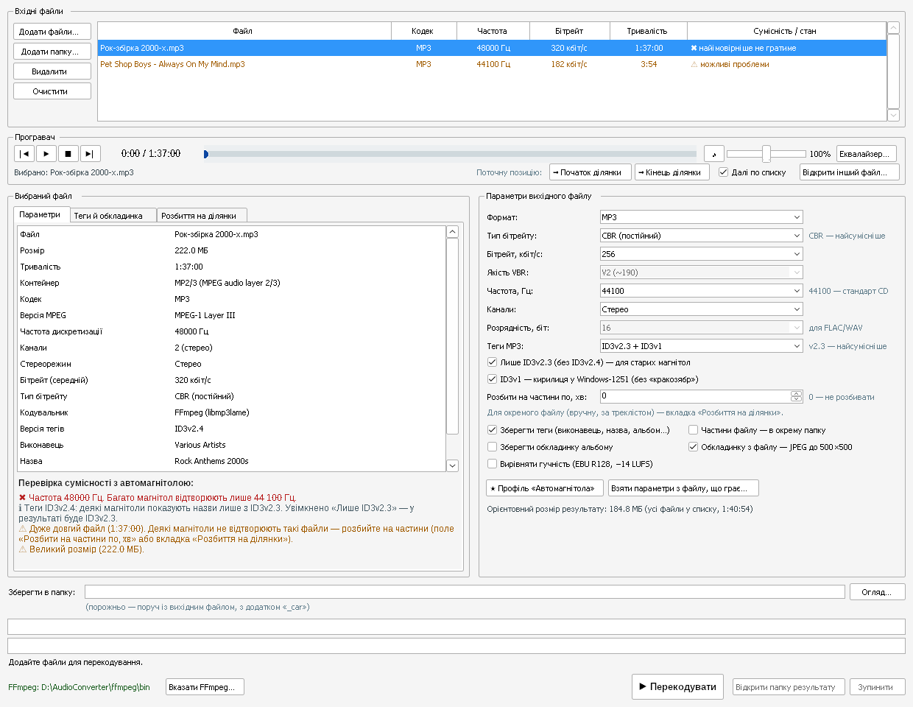
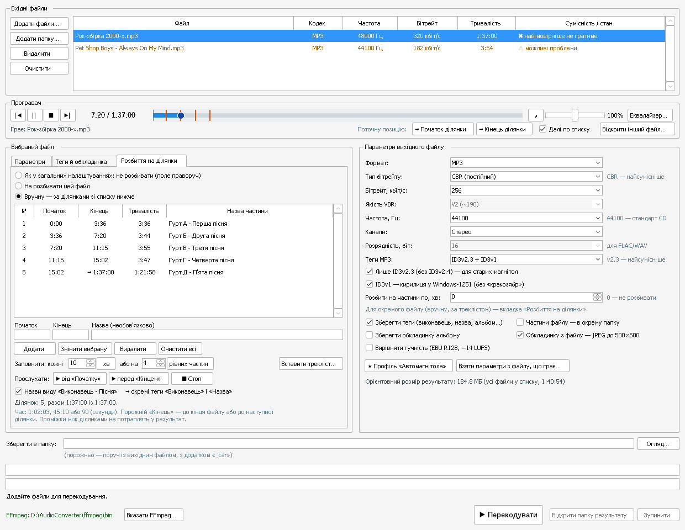
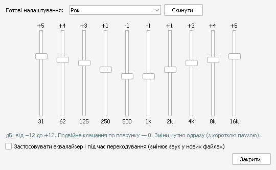
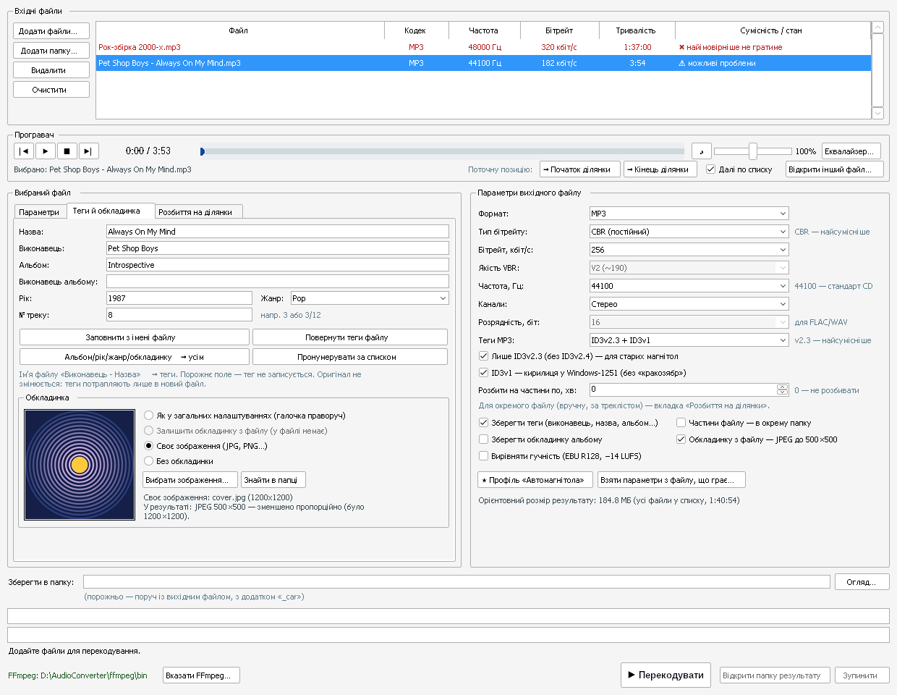
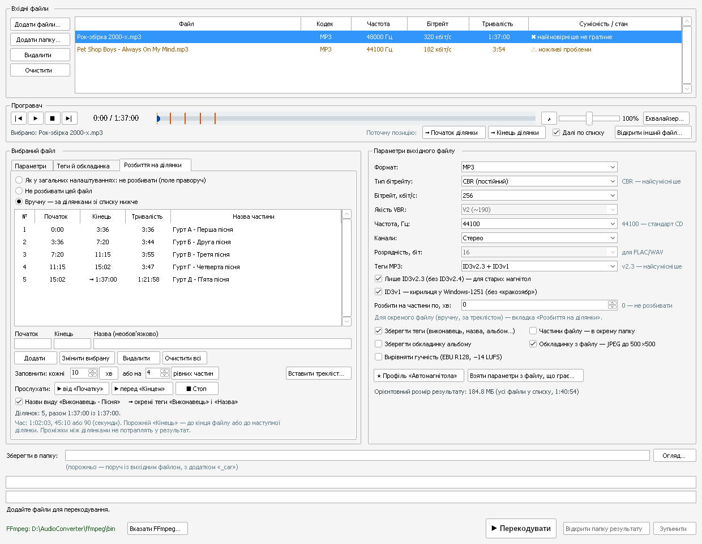
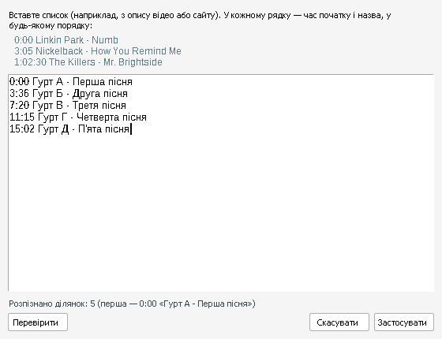
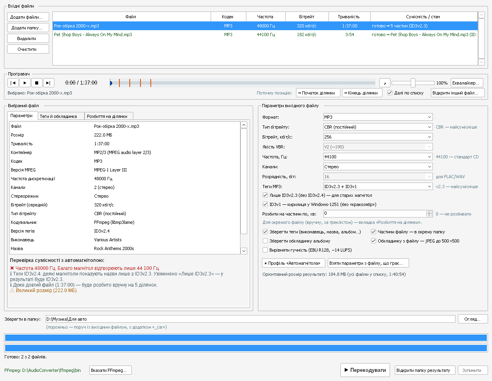

<p align="center"></p>

<h1 align="center">Аудіоконвертер для автомагнітоли<br><sub>Car Audio Converter</sub></h1>

<p align="center">


</p>

<p align="center">
<b>Українська</b> · <a href="#english">English</a><br>
Версія / Version 2.3
</p>

<p align="center"></p>

---

<a id="ukrainian"></a>

## Зміст

1. [Що вміє програма](#ua-features)
2. [Завантаження та встановлення](#ua-install)
3. [Швидкий старт](#ua-quick)
4. [Вікно програми](#ua-window)
5. [Програвач](#ua-player)
6. [Вкладка «Параметри»: перевірка сумісності](#ua-params)
7. [Вкладка «Теги й обкладинка»](#ua-tags)
8. [Вкладка «Розбиття на ділянки»](#ua-split)
9. [Параметри вихідного файлу](#ua-output)
10. [Перекодування й результат](#ua-convert)
11. [Поради для автомагнітоли](#ua-tips)
12. [Типові проблеми та рішення](#ua-faq)
13. [Для розробників: структура й збирання EXE](#ua-dev)
14. [Налаштування, оновлення, видалення](#ua-settings)
15. [Ліцензія](#ua-license)

<a id="ua-features"></a>

## 1. Що вміє програма

Багато автомагнітол «вибагливі»: не грають файли з частотою 48 000 Гц, змінним бітрейтом (VBR), великою обкладинкою чи тегами ID3v2.4, показують «кракозябри» замість кирилиці або не відкривають дуже довгі файли. Програма знаходить такі проблеми й перекодовує музику так, щоб вона гарантовано грала в машині.

- **Аналіз файлу**: кодек, частота, бітрейт (CBR/VBR), канали, версія тегів, обкладинка і зрозуміла перевірка сумісності з автомагнітолою.
- **Перекодування** в MP3, AAC (M4A), WMA, OGG, FLAC, WAV з потрібними параметрами. Профіль **«Автомагнітола»** одним натисканням: MP3, 44 100 Гц, CBR 256 кбіт/с, стерео, ID3v2.3.
- **«Взяти параметри з файлу, що грає»**: виберіть пісню, яку магнітола точно відтворює, і програма скопіює її параметри.
- **Теги**: назва, виконавець, альбом, рік, жанр, номер треку; заповнення з імені файлу, нумерація за списком.
- **Обкладинка**: своє зображення, з файлу або без неї. Великі картинки автоматично зменшуються до 500×500 зі збереженням пропорцій.
- **ID3v2.3 замість ID3v2.4** і **ID3v1 у Windows-1251**, щоб старі магнітоли показували українські назви.
- **Розбиття довгих файлів**: автоматично (кожні N хвилин, N рівних частин), вручну або за **треклістом** («0:00 Виконавець - Пісня»).
- **Вбудований програвач** із таймлайном, гучністю (до 200 %) та **10-смуговим еквалайзером**; позначки місць розрізу «на слух».
- Пакетна обробка: файли й цілі папки, два індикатори прогресу, оригінали не змінюються.

<a id="ua-install"></a>

## 2. Завантаження та встановлення

### Варіант А (рекомендовано): готовий пакет з EXE

1. Відкрийте сторінку [**Releases**](../../releases/latest) і завантажте `AudioConverter_2.3_Windows_x64.zip`.
2. Клацніть архів правою кнопкою → **Властивості** → якщо внизу є пункт **«Розблокувати»**, поставте галочку → **OK**.
3. Розпакуйте архів у звичайну папку, наприклад `C:\Programs\AudioConverter`. **Не запускайте програму просто з архіву.**
4. Запустіть `AudioConverter.exe`. Python і FFmpeg уже всередині пакета, нічого більше встановлювати не треба.

> Під час першого запуску Windows може показати синє вікно **«Windows захистив ваш комп'ютер»**. Натисніть **«Докладніше»** → **«Виконати однаково»**. Програма не має платного цифрового підпису, тому SmartScreen її «не знає». Детальніше — у розділі [Типові проблеми](#ua-faq) та в [інструкції до EXE](docs/EXE_INSTRUCTIONS.txt).

### Варіант Б: запуск із вихідного коду (Python)

1. Встановіть **Python 3.8 або новіший** з [python.org](https://www.python.org/downloads/). Під час встановлення поставте галочку **«Add python.exe to PATH»**.
2. Завантажте код: **Code → Download ZIP** на цій сторінці (або `git clone`) і розпакуйте.
3. Встановіть **FFmpeg**: запустіть `Install-FFmpeg.bat` (через winget) або завантажте `ffmpeg-release-essentials.zip` з [gyan.dev](https://www.gyan.dev/ffmpeg/builds/) і покладіть `ffmpeg.exe`, `ffprobe.exe`, `ffplay.exe` у папку `ffmpeg\bin` поруч із програмою.
4. Запустіть `Start.bat` (або двічі клацніть `audio_converter.pyw`).

Сторонні бібліотеки Python не потрібні: інтерфейс зроблено на вбудованому tkinter.

<a id="ua-quick"></a>

## 3. Швидкий старт (5 кроків)

1. **«Додати файли…»** або **«Додати папку…»** (можна також перетягнути файли на `AudioConverter.exe`).
2. Подивіться колонку **«Сумісність / стан»**: ✔ сумісний, ⚠ можливі проблеми, ✖ найімовірніше не гратиме.
3. Натисніть **«★ Профіль «Автомагнітола»»** праворуч.
4. За потреби поправте теги, обкладинку або розбиття на вкладках ліворуч.
5. Натисніть **«▶ Перекодувати»**. Готові файли з'являться поруч з оригіналами (з додатком `_car`) або у вибраній папці.

<a id="ua-window"></a>

## 4. Вікно програми


| Зона | Що там |
|---|---|
| **Вхідні файли** (вгорі) | Список файлів з кодеком, частотою, бітрейтом, тривалістю й оцінкою сумісності. Кнопки: додати файли/папку, видалити, очистити. |
| **Програвач** | Прослуховування, таймлайн, гучність, еквалайзер, позначки для розрізання. |
| **Вибраний файл** (ліворуч) | Три вкладки: «Параметри», «Теги й обкладинка», «Розбиття на ділянки». |
| **Параметри вихідного файлу** (праворуч) | Формат, бітрейт, частота, канали, теги, розбиття, обкладинка, профілі. |
| **Внизу** | Папка збереження, прогрес поточного файлу і всього списку, кнопки «Перекодувати», «Відкрити папку результату», «Зупинити», шлях до FFmpeg. |

<a id="ua-player"></a>

## 5. Програвач



- **Двічі клацніть** файл у списку (або виберіть його й натисніть **Enter** чи **▶**), і він заграє.
- Кнопки: **|◀** попередній файл (або на початок поточного), **▶ / ||** відтворення / пауза, **■** стоп, **▶|** наступний.
- **Таймлайн**: клацніть або перетягніть кружечок, щоб перемотати. **Колесо миші** над таймлайном перемотує на ±5 с. Помаранчеві риски — межі ділянок із вкладки «Розбиття».
- **Гучність**: повзунок 0–200 % (колесо миші: ±5 %), кнопка **♪** вимикає й вмикає звук.
- **«Еквалайзер…»** відкриває вікно з 10 смугами:

  

  - смуги 31 Гц … 16 кГц, від −12 до +12 дБ; **колесо миші** над повзунком: ±1 дБ; **подвійне клацання**: 0;
  - готові профілі: Плоский, Більше басів, Менше басів, Рок, Поп, Танцювальна, Джаз, Класика, Голос / аудіокнига, Більше високих; якщо змінити смуги вручну, профіль називається «Власне»;
  - галочка **«Застосовувати еквалайзер і під час перекодування»**: нові файли звучатимуть так само (праворуч з'явиться нагадування ⚠).
- **«Поточну позицію → Початок / Кінець ділянки»** переносить час, який зараз грає, у поля вкладки «Розбиття». Зручно, щоб різати збірку «на слух».
- **«Далі по списку»**: після кінця пісні грає наступна. **«Відкрити інший файл…»**: послухати будь-який файл, наприклад готовий результат.

> Звук відтворює `ffplay.exe` з комплекту FFmpeg. Після перемотування або зміни гучності чи еквалайзера звук на мить переривається. Це нормально.

<a id="ua-params"></a>

## 6. Вкладка «Параметри»: перевірка сумісності

Показує всі технічні параметри вибраного файлу і перелік зауважень:

- ✖ **червоні**: магнітола найімовірніше не відтворить файл (не той кодек, частота не 44 100 Гц, понад 2 канали тощо);
- ⚠ **жовті**: можливі проблеми (VBR, дуже довгий або великий файл, AAC);
- ℹ **сірі**: інформація (ID3v2.4, обкладинка, відсутні теги, заплановане розбиття).

<a id="ua-tags"></a>

## 7. Вкладка «Теги й обкладинка»



- Поля **Назва, Виконавець, Альбом, Виконавець альбому, Рік, Жанр, № треку** (наприклад, `3` або `3/12`). Порожнє поле означає, що тег не записується.
- **«Заповнити з імені файлу»**: `Виконавець - Назва.mp3` → теги (номер на початку, як-от `01 - `, відкидається).
- **«Повернути теги файлу»**: скасувати свої зміни.
- **«Альбом/рік/жанр/обкладинку → усім»**: скопіювати ці поля в усі файли списку.
- **«Пронумерувати за списком»**: № треку 1/N, 2/N… у порядку списку.
- **Обкладинка**: «Як у загальних налаштуваннях», «Залишити обкладинку з файлу», «Своє зображення» (JPG, PNG, BMP, WebP), «Без обкладинки». **«Знайти в папці»** шукає `cover.jpg`, `folder.jpg`, `front.jpg` поруч із піснею.
- Своє зображення **завжди** зберігається як JPEG, а якщо воно більше за 500×500, зменшується пропорційно (1200×900 → 500×375, 800×1600 → 250×500). Під мініатюрою видно, яким буде розмір.
- Обкладинку зберігають лише формати MP3, M4A та FLAC.

Оригінальні файли не змінюються: теги й обкладинка потрапляють лише в нові файли.

<a id="ua-split"></a>

## 8. Вкладка «Розбиття на ділянки»



Режими для вибраного файлу:

- **«Як у загальних налаштуваннях»**: за полем «Розбити на частини по, хв» праворуч (0 означає не розбивати);
- **«Не розбивати цей файл»**;
- **«Вручну»**: за списком ділянок.

Як задати ділянки:

- **Вручну**: «Початок», «Кінець» і (необов'язково) «Назва» → **«Додати»**. Формат часу: `1:02:03`, `45:10` або `90` (секунди). Порожній «Кінець» означає до наступної ділянки або до кінця файлу. **Проміжки між ділянками в результат не потрапляють**, тож так можна вирізати зайве.
- **Автоматично**: «Заповнити кожні N хв» або «на N рівних частин», потім за потреби підправити.
- **За треклістом**: **«Вставити трекліст…»** і вставте список з часом (наприклад, з опису відео):

  

  Підходять рядки на зразок `0:00 Назва`, `1. Виконавець - Пісня 3:45`, `[1:02:30] Назва`. Галочка **«Назви виду «Виконавець - Пісня» → окремі теги»** розділяє назву на теги «Виконавець» і «Назва».
- **Прослухати**: «▶ від «Початку»» і «▶ перед «Кінцем»», щоб точно знайти місце розрізу.

Частини отримують теги: назва (з назви ділянки або «… (частина N з M)»), № треку N/M, альбом (якщо порожній — назва вихідного файлу). Галочка **«Частини файлу — в окрему папку»** складає їх у папку з назвою файлу: `01 - Назва.mp3`, `02 - …`.

<a id="ua-output"></a>

## 9. Параметри вихідного файлу

| Параметр | Значення | Порада |
|---|---|---|
| Формат | MP3, AAC (M4A), WMA, OGG Vorbis, FLAC, WAV | **MP3** — найсумісніший |
| Тип бітрейту | CBR (постійний) / VBR (змінний) | **CBR** для магнітол |
| Бітрейт | 32–320 кбіт/с | 192–256 кбіт/с |
| Якість VBR | V0 (~245) … V9 (~65) | лише для VBR |
| Частота | 44 100, 48 000, 32 000… Гц | **44 100 Гц** |
| Канали | Як у вихідному / Стерео / Моно | Стерео |
| Розрядність | 16 / 24 біт | для FLAC і WAV |
| Теги MP3 | ID3v2.3 + ID3v1 / ID3v2.3 / ID3v2.4 | ID3v2.3 + ID3v1 |
| Лише ID3v2.3 | галочка | увімкнено |
| ID3v1 у Windows-1251 | галочка | увімкнено (кирилиця на старих магнітолах) |
| Розбити на частини по, хв | 0–120 | 20–30 хв для довгих збірок |
| Зберегти теги | галочка | переносити теги з оригіналу |
| Зберегти обкладинку альбому | галочка | вимкнено в профілі «Автомагнітола» |
| Обкладинку з файлу — JPEG до 500×500 | галочка | увімкнено |
| Частини файлу — в окрему папку | галочка | для збірок |
| Вирівняти гучність | EBU R128, −14 LUFS | для збірок з різною гучністю |

Кнопки: **«★ Профіль «Автомагнітола»»** і **«Взяти параметри з файлу, що грає…»**. Під кнопками показано орієнтовний розмір результату.

<a id="ua-convert"></a>

## 10. Перекодування й результат



- **«Зберегти в папку»**: якщо поле порожнє, файли з'являться поруч з оригіналами з додатком `_car`.
- **«▶ Перекодувати»** обробляє **всі** файли списку. Два індикатори показують прогрес поточного файлу і всього списку. **«Зупинити»** перериває роботу (недороблений файл видаляється).
- У колонці «Сумісність / стан» видно результат, наприклад `готово → 5 частин (ID3v2.3)`.
- **«Відкрити папку результату»** відкриває папку в Провіднику.

<a id="ua-tips"></a>

## 11. Поради для автомагнітоли

- Флешка у **FAT32** (не NTFS і не exFAT), бажано до 32 ГБ; у папці не більше ~999 файлів.
- Короткі імена файлів і папок, без емодзі.
- Якщо не грає: спробуйте бітрейт 192 або 128 кбіт/с, вимкніть обкладинку, розбийте довгий файл на частини по 20–30 хв.
- Щоб підібрати параметри, скористайтеся кнопкою «Взяти параметри з файлу, що грає…».

<a id="ua-faq"></a>

## 12. Типові проблеми та рішення

| Проблема | Рішення |
|---|---|
| Синє вікно «Windows захистив ваш комп'ютер» | «Докладніше» → «Виконати однаково». Програма не має платного цифрового підпису, тому SmartScreen її «не знає». |
| Антивірус видаляє або блокує `AudioConverter.exe` | Це хибне спрацювання, типове для програм, зібраних PyInstaller. Додайте папку програми до винятків антивірусу або Windows Defender (Захист від вірусів і загроз → Керування параметрами → Винятки). Або запускайте з вихідного коду (Варіант Б). |
| «FFmpeg: НЕ ЗНАЙДЕНО» | Перевірте, що поруч з програмою є `ffmpeg\bin\ffmpeg.exe` і `ffprobe.exe`. Або натисніть «Вказати FFmpeg…» і виберіть папку з ними. |
| Програвач не грає або немає звуку | Перевірте, що є `ffmpeg\bin\ffplay.exe`; що вибрано правильний пристрій виведення (значок динаміка у Windows); що гучність у програмі не 0 % і звук не вимкнено (♪). Після підключення навушників або Bluetooth натисніть ■ і ▶ знову. |
| Колесо миші не змінює гучність | Наведіть курсор саме на повзунок (або значення %), потім крутіть колесо. |
| Файл «✖ не вдалося прочитати» | Файл пошкоджений або це не аудіо. Спробуйте відкрити його в іншому програвачі. |
| Помилка перекодування | Текст помилки FFmpeg показується у вікні. Часто допомагає інший формат або бітрейт; перевірте вільне місце на диску й права на запис у папку збереження. |
| Магнітола показує «кракозябри» | Увімкніть «ID3v1 — кирилиця у Windows-1251» і «Лише ID3v2.3». |
| Магнітола не бачить файл | MP3, 44 100 Гц, CBR, ID3v2.3, без обкладинки; флешка у FAT32. |
| Вікно не вміщується на екран | Розгорніть вікно на весь екран; мінімальний розмір 1060×820. На ноутбуках з масштабом 150 % спробуйте 125 % (Параметри Windows → Дисплей). |

<a id="ua-dev"></a>

## 13. Для розробників: структура й збирання EXE

```
├─ audio_converter.pyw     програма (один файл, Python 3.8+, tkinter)
├─ AudioConverter.ico      значок
├─ Start.bat               запуск із вихідного коду
├─ Install-FFmpeg.bat      встановлення FFmpeg через winget
├─ build_exe.bat           збирання AudioConverter.exe (PyInstaller)
├─ docs\
│  ├─ index.html           ця документація як вебсторінка (для GitHub Pages)
│  ├─ EXE_INSTRUCTIONS.txt інструкція до пакета з EXE (UA/EN)
│  └─ img\                 скриншоти й значок
├─ CHANGELOG.md            історія версій
└─ LICENSE                 ліцензія MIT
```

**Збирання EXE.** Запустіть `build_exe.bat`: він встановить PyInstaller і створить `dist\AudioConverter\AudioConverter.exe`. Потім покладіть `ffmpeg.exe`, `ffprobe.exe`, `ffplay.exe` (і DLL, якщо збірка «shared») у `dist\AudioConverter\ffmpeg\bin`, додайте `docs\EXE_INSTRUCTIONS.txt` і запакуйте папку в zip для сторінки Releases. Програма шукає FFmpeg у такому порядку: папка, вказана кнопкою «Вказати FFmpeg…»; поруч із програмою та в `ffmpeg\bin`; `PATH`; типові місця встановлення winget.

**Документація на GitHub Pages.** Settings → Pages → Source: *Deploy from a branch*, гілка `main`, папка `/docs`. Сторінка `docs/index.html` сама знайде посилання на останній реліз.

<a id="ua-settings"></a>

## 14. Налаштування, оновлення, видалення

- Налаштування (останні параметри, папки, еквалайзер, гучність) зберігаються у `%APPDATA%\AudioConverterCar\settings.json`.
- **Оновлення**: розпакуйте нову версію замість старої папки (налаштування збережуться).
- **Видалення**: видаліть папку програми та, за бажанням, `%APPDATA%\AudioConverterCar`. Програма нічого не записує в реєстр і системні папки.

<a id="ua-license"></a>

## 15. Ліцензія

Код програми поширюється за ліцензією [MIT](LICENSE). Пакет з EXE на сторінці Releases містить сторонні компоненти: **FFmpeg 8.1** (LGPL 3.0+, збірка [BtbN](https://github.com/BtbN/FFmpeg-Builds), з бібліотеками LAME, SoX Resampler, Vorbis, SDL2), **Python** (PSF License), **Tcl/Tk** (BSD-подібна ліцензія), завантажувач **PyInstaller** (GPL з винятком для поширення). Повні тексти — у файлі `THIRD-PARTY-LICENSES.txt` всередині пакета.

---

<a id="english"></a>

<p align="center"><a href="#ukrainian">Українська</a> · <b>English</b></p>

## Contents

1. [Features](#en-features)
2. [Download and installation](#en-install)
3. [Quick start](#en-quick)
4. [Main window](#en-window)
5. [Player](#en-player)
6. [“Параметри” tab: compatibility check](#en-params)
7. [“Теги й обкладинка” tab: tags and cover art](#en-tags)
8. [“Розбиття на ділянки” tab: splitting](#en-split)
9. [Output settings](#en-output)
10. [Converting and results](#en-convert)
11. [Car stereo tips](#en-tips)
12. [Troubleshooting](#en-faq)
13. [For developers: layout and building the EXE](#en-dev)
14. [Settings, updating, uninstalling](#en-settings)
15. [License](#en-license)

> The program interface is in Ukrainian. Below, each control is given with its Ukrainian label and an English translation, e.g. **«Перекодувати»** (*Convert*).

<a id="en-features"></a>

## 1. Features

Many car stereos are picky: they refuse 48 kHz files, variable bitrate (VBR), large embedded cover art or ID3v2.4 tags, show garbled Cyrillic text, or can't open very long files. The program detects these problems and re-encodes music so that it reliably plays in the car.

- **File analysis**: codec, sample rate, bitrate (CBR/VBR), channels, tag version, cover art, plus a plain-language car-stereo compatibility check.
- **Conversion** to MP3, AAC (M4A), WMA, OGG, FLAC, WAV. One-click **Car stereo** profile («★ Профіль «Автомагнітола»»): MP3, 44,100 Hz, CBR 256 kbps, stereo, ID3v2.3.
- **Copy settings from a file that plays** («Взяти параметри з файлу, що грає…»): pick a song your stereo definitely plays, and its parameters are copied.
- **Tags**: title, artist, album, album artist, year, genre, track number; fill from the file name, number tracks by list order.
- **Cover art**: your own image, the file's own cover, or none. Large images are automatically scaled down to 500×500, keeping proportions.
- **ID3v2.3 only** (instead of ID3v2.4) and **ID3v1 in Windows-1251**, so older stereos display Cyrillic titles.
- **Splitting long files**: automatically (every N minutes, N equal parts), manually, or from a **track list** (“0:00 Artist - Song”).
- **Built-in player** with timeline, volume (up to 200%) and a **10-band equalizer**; mark cut points by ear.
- Batch processing of files and whole folders; two progress bars; original files are never modified.

<a id="en-install"></a>

## 2. Download and installation

### Option A (recommended): EXE package

1. Open [**Releases**](../../releases/latest) and download `AudioConverter_2.3_Windows_x64.zip`.
2. Right-click the archive → **Properties** → if there is an **Unblock** checkbox at the bottom, tick it → **OK**.
3. Extract the archive to a normal folder, e.g. `C:\Programs\AudioConverter`. **Do not run the program from inside the zip.**
4. Run `AudioConverter.exe`. Python and FFmpeg are already included; nothing else needs to be installed.

> On first launch Windows may show a blue **“Windows protected your PC”** window. Click **More info** → **Run anyway**. The program has no paid code-signing certificate, so SmartScreen does not “know” it. See [Troubleshooting](#en-faq) and the [EXE instructions](docs/EXE_INSTRUCTIONS.txt).

### Option B: run from source (Python)

1. Install **Python 3.8 or newer** from [python.org](https://www.python.org/downloads/); tick **“Add python.exe to PATH”**.
2. Get the code: **Code → Download ZIP** on this page (or `git clone`) and extract it.
3. Install **FFmpeg**: run `Install-FFmpeg.bat` (uses winget) or download `ffmpeg-release-essentials.zip` from [gyan.dev](https://www.gyan.dev/ffmpeg/builds/) and put `ffmpeg.exe`, `ffprobe.exe`, `ffplay.exe` into an `ffmpeg\bin` folder next to the program.
4. Run `Start.bat` (or double-click `audio_converter.pyw`).

No third-party Python packages are needed: the interface uses the built-in tkinter.

<a id="en-quick"></a>

## 3. Quick start (5 steps)

1. **«Додати файли…»** (*Add files…*) or **«Додати папку…»** (*Add folder…*). You can also drag files onto `AudioConverter.exe`.
2. Check the **«Сумісність / стан»** (*Compatibility / status*) column: ✔ compatible, ⚠ possible problems, ✖ most likely won't play.
3. Click **«★ Профіль «Автомагнітола»»** (*Car stereo profile*) on the right.
4. If needed, adjust tags, cover art or splitting in the tabs on the left.
5. Click **«▶ Перекодувати»** (*Convert*). The new files appear next to the originals (with a `_car` suffix) or in the chosen folder.

<a id="en-window"></a>

## 4. Main window


| Area | Contents |
|---|---|
| **«Вхідні файли»** (*Input files*, top) | File list with codec, sample rate, bitrate, duration and compatibility verdict; add files/folder, remove, clear. |
| **«Програвач»** (*Player*) | Playback, timeline, volume, equalizer, cut-point markers. |
| **«Вибраний файл»** (*Selected file*, left) | Three tabs: «Параметри» (*Details*), «Теги й обкладинка» (*Tags & cover*), «Розбиття на ділянки» (*Splitting*). |
| **«Параметри вихідного файлу»** (*Output settings*, right) | Format, bitrate, sample rate, channels, tags, splitting, cover options, profiles. |
| **Bottom** | Output folder, per-file and overall progress, «Перекодувати» (*Convert*), «Відкрити папку результату» (*Open output folder*), «Зупинити» (*Stop*), FFmpeg path. |

<a id="en-player"></a>

## 5. Player


- **Double-click** a file in the list (or select it and press **Enter** / **▶**) to play it.
- Buttons: **|◀** previous file (or restart current), **▶ / ||** play / pause, **■** stop, **▶|** next.
- **Timeline**: click or drag the knob to seek; the **mouse wheel** over the timeline seeks ±5 s. Orange marks are segment boundaries from the Splitting tab.
- **Volume**: slider 0–200% (mouse wheel: ±5%); the **♪** button mutes/unmutes.
- **«Еквалайзер…»** (*Equalizer…*) opens a 10-band equalizer:

  

  - bands 31 Hz … 16 kHz, −12 … +12 dB; **mouse wheel** over a slider: ±1 dB; **double-click**: reset to 0;
  - presets: Flat, More bass, Less bass, Rock, Pop, Dance, Jazz, Classical, Voice / audiobook, More treble; manual changes are shown as «Власне» (*Custom*);
  - checkbox **«Застосовувати еквалайзер і під час перекодування»** (*Also apply the equalizer when converting*): new files will sound the same (a ⚠ reminder appears on the right).
- **«Поточну позицію → Початок / Кінець ділянки»** (*Current position → Segment start / end*) copies the playing time into the Splitting tab, so you can cut a compilation by ear.
- **«Далі по списку»** (*Continue with next*) plays the next file automatically. **«Відкрити інший файл…»** (*Open another file…*) plays any file, e.g. a converted result.

> Sound is played by `ffplay.exe` from the FFmpeg package. After seeking or changing volume/EQ the sound pauses briefly. This is normal.

<a id="en-params"></a>

## 6. “Параметри” (*Details*) tab: compatibility check

Shows all technical properties of the selected file and a list of remarks:

- ✖ **red**: the stereo will most likely not play the file (wrong codec, sample rate other than 44,100 Hz, more than 2 channels…);
- ⚠ **amber**: possible problems (VBR, very long or large file, AAC);
- ℹ **grey**: information (ID3v2.4, cover art, missing tags, planned splitting).

<a id="en-tags"></a>

## 7. “Теги й обкладинка” (*Tags & cover*) tab


- Fields **Title, Artist, Album, Album artist, Year, Genre, Track** (e.g. `3` or `3/12`). An empty field means the tag is not written.
- **«Заповнити з імені файлу»** (*Fill from file name*): `Artist - Title.mp3` → tags (a leading number like `01 - ` is skipped).
- **«Повернути теги файлу»** (*Restore file tags*): undo your edits.
- **«Альбом/рік/жанр/обкладинку → усім»** (*Album/year/genre/cover → all*): copy these fields to every file in the list.
- **«Пронумерувати за списком»** (*Number by list*): track 1/N, 2/N… in list order.
- **Cover art**: *As in global settings*, *Keep the file's cover*, *Own image* (JPG, PNG, BMP, WebP), *No cover*. **«Знайти в папці»** (*Find in folder*) looks for `cover.jpg`, `folder.jpg`, `front.jpg` next to the song.
- An own image is **always** saved as JPEG and, if larger than 500×500, scaled down proportionally (1200×900 → 500×375, 800×1600 → 250×500). The resulting size is shown under the thumbnail.
- Only MP3, M4A and FLAC store cover art.

Original files are not modified: tags and cover art go only into the new files.

<a id="en-split"></a>

## 8. “Розбиття на ділянки” (*Splitting*) tab


Modes for the selected file:

- **As in global settings**: the “Split into parts every, min” field on the right (0 means no splitting);
- **Do not split this file**;
- **Manual**: use the segment list.

Defining segments:

- **Manually**: *Start*, *End* and an optional *Name* → **«Додати»** (*Add*). Time format: `1:02:03`, `45:10` or `90` (seconds). An empty *End* means up to the next segment or the end of the file. **Gaps between segments are not included**, so you can cut out unwanted parts.
- **Automatically**: *Fill every N min* or *into N equal parts*, then adjust if needed.
- **From a track list**: **«Вставити трекліст…»** (*Paste track list…*) and paste a list with times (e.g. from a video description):

  

  Lines like `0:00 Title`, `1. Artist - Song 3:45`, `[1:02:30] Title` are recognized. The checkbox **“Names like ‘Artist - Song’ → separate tags”** splits them into Artist and Title tags.
- **Listen**: *▶ from Start* and *▶ before End* to find the exact cut point.

Parts get tags: title (segment name or “… (part N of M)”), track N/M, album (the source file name if empty). The checkbox **«Частини файлу — в окрему папку»** (*Put parts into a separate folder*) creates a folder named after the file with `01 - Name.mp3`, `02 - …`.

<a id="en-output"></a>

## 9. Output settings

| Setting | Values | Recommendation |
|---|---|---|
| Формат (*Format*) | MP3, AAC (M4A), WMA, OGG Vorbis, FLAC, WAV | **MP3**, the most compatible |
| Тип бітрейту (*Bitrate mode*) | CBR / VBR | **CBR** for car stereos |
| Бітрейт (*Bitrate*) | 32–320 kbps | 192–256 kbps |
| Якість VBR (*VBR quality*) | V0 (~245) … V9 (~65) | VBR only |
| Частота (*Sample rate*) | 44,100, 48,000, 32,000… Hz | **44,100 Hz** |
| Канали (*Channels*) | Source / Stereo / Mono | Stereo |
| Розрядність (*Bit depth*) | 16 / 24 bit | FLAC and WAV |
| Теги MP3 (*MP3 tags*) | ID3v2.3 + ID3v1 / ID3v2.3 / ID3v2.4 | ID3v2.3 + ID3v1 |
| Лише ID3v2.3 (*ID3v2.3 only*) | checkbox | on |
| ID3v1 у Windows-1251 | checkbox | on (Cyrillic on older stereos) |
| Розбити на частини по, хв (*Split every, min*) | 0–120 | 20–30 min for long compilations |
| Зберегти теги (*Keep tags*) | checkbox | copy tags from the original |
| Зберегти обкладинку (*Keep cover art*) | checkbox | off in the Car stereo profile |
| Обкладинку з файлу — JPEG до 500×500 | checkbox | on (scales down the file's own cover) |
| Частини — в окрему папку (*Parts into a folder*) | checkbox | for compilations |
| Вирівняти гучність (*Normalize loudness*) | EBU R128, −14 LUFS | for mixed-loudness compilations |

Buttons: **Car stereo profile** and **Copy settings from a file that plays…**. The estimated output size is shown below them.

<a id="en-convert"></a>

## 10. Converting and results


- **«Зберегти в папку»** (*Save to folder*): if empty, files are saved next to the originals with a `_car` suffix.
- **«▶ Перекодувати»** (*Convert*) processes **all** files in the list. Two progress bars show the current file and the whole list. **«Зупинити»** (*Stop*) aborts (the unfinished file is deleted).
- The *Compatibility / status* column shows the result, e.g. `готово → 5 частин (ID3v2.3)` (*done → 5 parts*).
- **«Відкрити папку результату»** (*Open output folder*) opens it in Explorer.

<a id="en-tips"></a>

## 11. Car stereo tips

- USB stick formatted as **FAT32** (not NTFS or exFAT), preferably ≤ 32 GB; no more than ~999 files per folder.
- Short file and folder names, no emoji.
- If a file still doesn't play: try 192 or 128 kbps, disable cover art, split long files into 20–30 minute parts.
- Use **Copy settings from a file that plays…** to match a known-good file.

<a id="en-faq"></a>

## 12. Troubleshooting

| Problem | Solution |
|---|---|
| Blue “Windows protected your PC” window | Click **More info** → **Run anyway**. The program has no paid code-signing certificate, so SmartScreen does not “know” it. |
| Antivirus deletes or blocks `AudioConverter.exe` | A false positive common for PyInstaller-built programs. Add the program folder to your antivirus / Windows Defender exclusions (Virus & threat protection → Manage settings → Exclusions), or run from source (Option B). |
| «FFmpeg: НЕ ЗНАЙДЕНО» (*FFmpeg: NOT FOUND*) | Make sure `ffmpeg\bin\ffmpeg.exe` and `ffprobe.exe` are next to the program, or click «Вказати FFmpeg…» (*Locate FFmpeg…*) and choose their folder. |
| Player is silent | Check that `ffmpeg\bin\ffplay.exe` exists, the correct Windows output device is selected, the volume is not 0% and the sound is not muted (♪). After plugging in headphones/Bluetooth press ■ and ▶ again. |
| Mouse wheel does not change volume | Hover over the slider itself (or the % value), then scroll. |
| “✖ не вдалося прочитати” (*could not read*) | The file is damaged or not audio; try another player. |
| Conversion error | The FFmpeg error text is shown. Try another format/bitrate; check free disk space and write permission for the output folder. |
| Garbled text on the stereo | Enable “ID3v1 in Windows-1251” and “ID3v2.3 only”. |
| Stereo does not see the file | MP3, 44,100 Hz, CBR, ID3v2.3, no cover art; FAT32 USB stick. |
| Window doesn't fit the screen | Maximize the window (minimum size 1060×820); on laptops at 150% scaling try 125% (Windows Settings → Display). |

<a id="en-dev"></a>

## 13. For developers: layout and building the EXE

```
├─ audio_converter.pyw     the program (single file, Python 3.8+, tkinter)
├─ AudioConverter.ico      icon
├─ Start.bat               run from source
├─ Install-FFmpeg.bat      install FFmpeg via winget
├─ build_exe.bat           build AudioConverter.exe (PyInstaller)
├─ docs\
│  ├─ index.html           this documentation as a web page (for GitHub Pages)
│  ├─ EXE_INSTRUCTIONS.txt instructions for the EXE package (UA/EN)
│  └─ img\                 screenshots and icon
├─ CHANGELOG.md            version history
└─ LICENSE                 MIT license
```

**Building the EXE.** Run `build_exe.bat`: it installs PyInstaller and creates `dist\AudioConverter\AudioConverter.exe`. Then put `ffmpeg.exe`, `ffprobe.exe`, `ffplay.exe` (plus DLLs for a “shared” build) into `dist\AudioConverter\ffmpeg\bin`, add `docs\EXE_INSTRUCTIONS.txt`, and zip the folder for the Releases page. FFmpeg is searched in this order: the folder chosen with «Вказати FFmpeg…»; next to the program and in `ffmpeg\bin`; `PATH`; typical winget install locations.

**Documentation on GitHub Pages.** Settings → Pages → Source: *Deploy from a branch*, branch `main`, folder `/docs`. The page `docs/index.html` finds the latest release link by itself.

<a id="en-settings"></a>

## 14. Settings, updating, uninstalling

- Settings (last parameters, folders, equalizer, volume) are stored in `%APPDATA%\AudioConverterCar\settings.json`.
- **Update**: extract the new version over the old folder; settings are kept.
- **Uninstall**: delete the program folder and, optionally, `%APPDATA%\AudioConverterCar`. Nothing is written to the registry or system folders.

<a id="en-license"></a>

## 15. License

The program code is released under the [MIT License](LICENSE). The EXE package on the Releases page includes third-party components: **FFmpeg 8.1** (LGPL 3.0+, [BtbN](https://github.com/BtbN/FFmpeg-Builds) build, with LAME, SoX Resampler, Vorbis, SDL2), **Python** (PSF License), **Tcl/Tk** (BSD-style license), and the **PyInstaller** bootloader (GPL with a distribution exception). Full texts are in `THIRD-PARTY-LICENSES.txt` inside the package.
